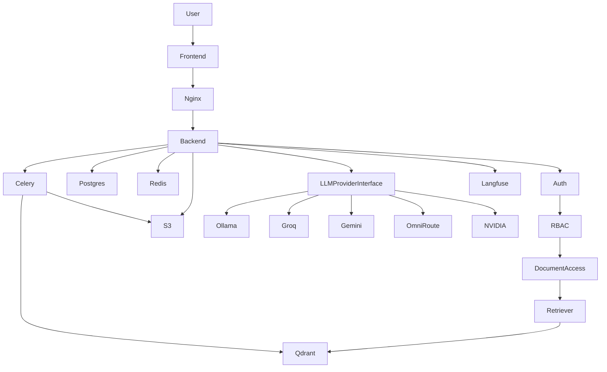
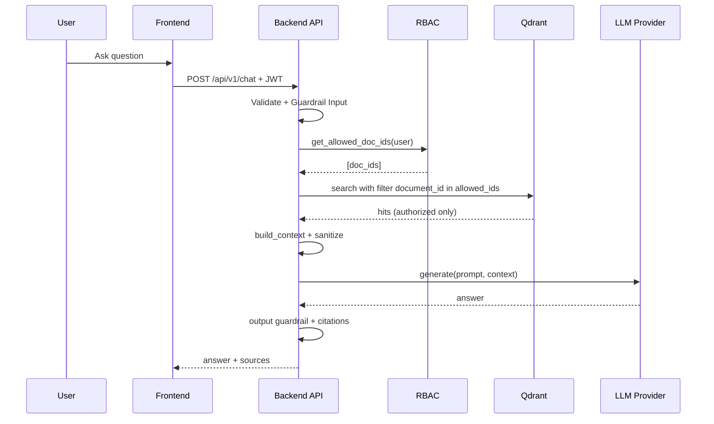
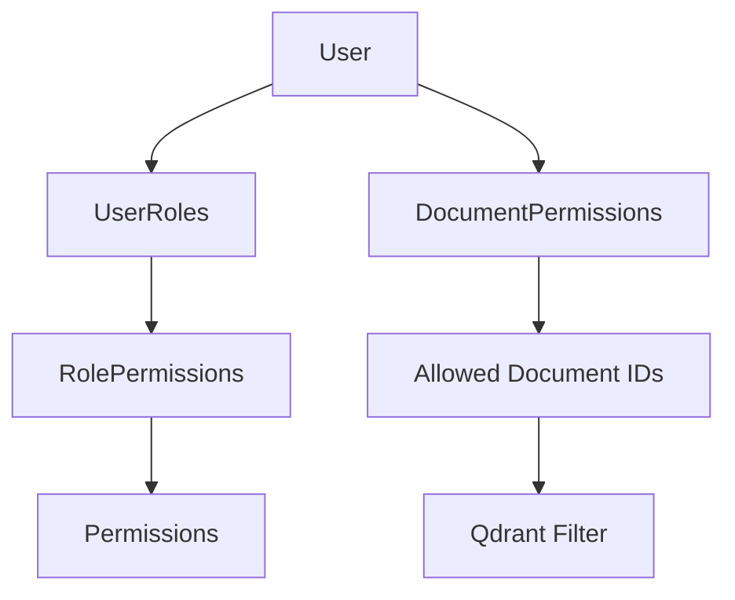
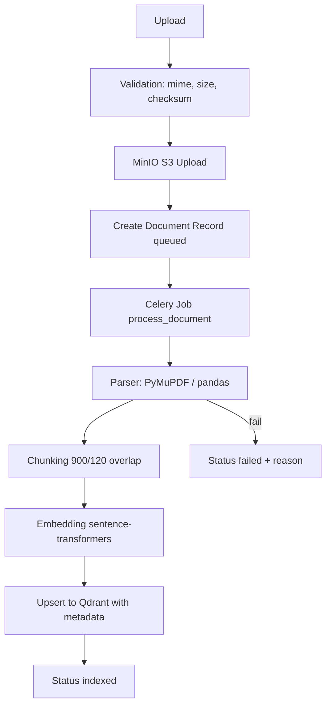
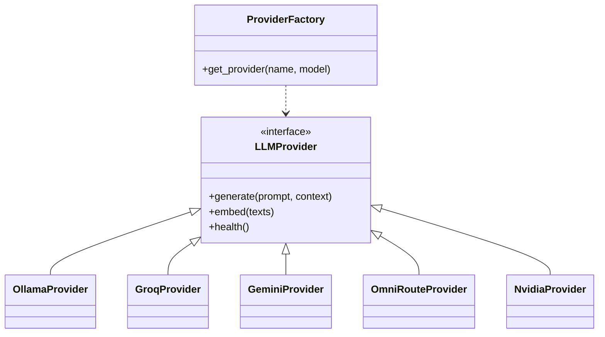
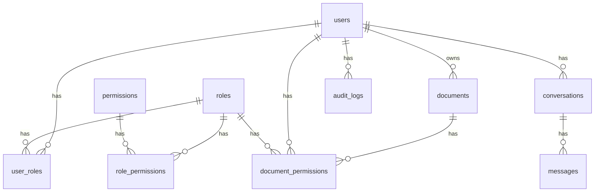

# Enterprise RAG with RBAC


An internal AI knowledge assistant for PDF and Excel files. Answers are grounded in your documents, cite their sources, and respect document-level access control: users only ever retrieve chunks from documents they are allowed to see.

> This is the single project document. It contains the overview, setup, architecture, API reference, contributing guide, and maintenance log.

## Contents

- [Features](#features)
- [Implementation status](#implementation-status)
- [Project layout](#project-layout)
- [Prerequisites](#prerequisites)
- [Quick start (Docker)](#quick-start-docker)
- [Make targets](#make-targets)
- [Environment variables](#environment-variables)
- [Local development](#local-development)
- [Architecture](#architecture)
- [API (v1)](#api-v1)
- [RBAC model](#rbac-model)
- [Testing](#testing)
- [Troubleshooting](#troubleshooting)
- [Deployment](#deployment)
- [Where to modify?](#where-to-modify)
- [Contributing](#contributing)
- [License](#license)

## Features

- JWT access/refresh tokens, bcrypt password hashing, roles: `super_admin`, `admin`, `manager`, `employee`
- Document-level access control applied **before** retrieval (Qdrant filter on allowed document IDs)
- PDF (PyMuPDF) and Excel (pandas/openpyxl) ingestion: Upload → validation → MinIO → Celery → parse → chunk → embed → Qdrant
- Provider abstraction with adapters for Ollama, Groq, Gemini, OmniRoute and NVIDIA
- Input/output guardrails; document text is treated as data (wrapped in `[DOCUMENT DATA]` markers), not instructions
- Admin UI: users and roles, LLM provider configs, audit log
- Modern UI: dark mode, responsive layout, upload progress, status badges, citation cards, toasts, loading skeletons

### Implementation status

| Capability | Status |
|---|---|
| Chat responses | **Working.** Request/response with real retrieval + provider generation; sources returned when requested. Token streaming (SSE/WebSocket) is **planned, not implemented**. |
| Reranking | **Not implemented.** Results come straight from Qdrant top‑k. |
| Langfuse tracing | **Implemented but off by default.** `app/observability/tracing.py` sends real trace/span/generation events when `LANGFUSE_*` keys are set; a no-op keeps the RAG path branches-free when blank. |
| Chat rate limiting | **Implemented.** Redis fixed-window dependency in `app/utils/rate_limit.py`; 429 + `Retry-After` when exhausted. |
| Ragas evaluation | **Implemented (lexical proxies).** `app/evaluation/runner.py` computes context_precision@k, context_recall, faithfulness, answer_relevancy from **real** retrieval + generation (documented as lexical proxies, not LLM-judge). `POST /evaluation/run` persists real per-case scores in `case_details`. |
| DB migrations | **Alembic is set up with a real migration.** `backend/alembic/versions/` holds the initial schema (verified to reproduce the live schema column-for-column); `alembic stamp head` marks pre-existing databases. `create_all` + `ensure_schema_additions()` still run at startup as a safety net for dev DBs. `make migrate` / `make migrate-rev m="..."` / `make migrate-stamp`. |
| LLM API keys in admin UI | Only a truncated mask is stored; provider calls use keys from environment variables. |

## Project layout

```text
backend/       FastAPI API, workers, migrations, and backend tests
frontend/      Next.js web application
.env.example   Environment template (copy to .env)
docker-compose.yml  Local and container deployment stack
Makefile       Common development and operations commands
```

## Prerequisites

| Tool | Version | Needed for |
|---|---|---|
| Docker | >= 20.x | Running the stack |
| Docker Compose | >= 2.x (`docker compose`) | Running the stack |
| Node.js | >= 18.x | Local frontend development |
| Python | >= 3.11 | Local backend development |
| `make` | any | Optional shortcuts |

## Quick start (Docker)

```bash
cp .env.example .env        # then edit: set SECRET_KEY and at least one LLM key
make up                     # or: docker compose up -d --build
make seed                   # creates roles + the default admin (first run only)
```

| Service | URL |
|---|---|
| App (via nginx) | http://localhost |
| Frontend direct | http://localhost:1357 |
| API docs | http://localhost:2357/docs |
| MinIO console | http://localhost:9001 |

### Default admin login

`make seed` (which runs `python -m scripts.seed_admin`) creates:

| Email | Password |
|---|---|
| `admin@example.com` | `Admin@12345` |

Override with `ADMIN_EMAIL`, `ADMIN_PASSWORD`, `ADMIN_FULL_NAME` in `.env`, or pass `--email/--password`. **Change this password before any shared deployment.** With `ENV=production` the script refuses to use the default password. The script is idempotent; use `--reset-password` to reset an existing admin.

## Make targets

`make up` · `make down` · `make logs [s=backend]` · `make ps` · `make seed` · `make test` · `make test-cov` · `make lint` · `make typecheck` · `make shell` · `make clean` — run `make help` for the list.

## Environment variables

Copy `.env.example` to `.env`. **Never commit `.env`** (it is in `.gitignore`).

| Variable | Required | Default / example | Description |
|---|---|---|---|
| `ENV` | No | `development` | `production` blocks the default seed password |
| `SECRET_KEY` | **Yes** | — | JWT signing secret; use a long random value |
| `JWT_ACCESS_EXPIRE_MIN` | No | `30` | Access token lifetime (minutes) |
| `JWT_REFRESH_EXPIRE_DAYS` | No | `7` | Refresh token lifetime (days) |
| `POSTGRES_USER` / `POSTGRES_PASSWORD` / `POSTGRES_DB` | **Yes** (Docker) | `raguser` / — / `enterprise_rag` | Postgres container credentials |
| `POSTGRES_HOST_PORT` | No | `5433` | Host port mapped to Postgres `5432` (raise it if `5433` is taken) |
| `DATABASE_URL` | **Yes** | `postgresql://…@postgres:5432/enterprise_rag` | SQLAlchemy connection string |
| `REDIS_URL` | **Yes** | `redis://redis:6379/0` | Celery broker/backend |
| `QDRANT_URL` | **Yes** | `http://qdrant:6333` | Vector database |
| `QDRANT_API_KEY` | No | blank | Only if your Qdrant requires it |
| `S3_ENDPOINT` / `S3_ACCESS_KEY` / `S3_SECRET_KEY` | **Yes** | MinIO defaults | Object storage for uploads (also the MinIO root credentials) |
| `S3_BUCKET` / `S3_REGION` | No | `enterprise-rag-docs` / `us-east-1` | Bucket settings |
| `MAX_UPLOAD_MB` | No | `50` | Max upload size (keep `nginx.conf` limit slightly higher) |
| `RATE_LIMIT_CHAT_PER_MIN` | No | `20` | Chat calls per minute per user (Redis fixed window, 429 on breach) |
| `RATE_LIMIT_AUTH_PER_MIN` | No | `10` | Per-minute budget for `register` / `login` / `forgot-password` / `reset-password` (each endpoint has its own window) |
| `APP_BASE_URL` | No | `http://localhost:1357` | Base used to build password-reset links (should point to the frontend) |
| `PASSWORD_RESET_TTL_MIN` | No | `30` | How long a reset link stays valid |
| `SMTP_HOST` / `SMTP_PORT` / `SMTP_USER` / `SMTP_PASSWORD` / `SMTP_FROM` | No | blank | Outbound mail for reset links. Unset = the link is logged instead of mailed, and `/auth/forgot-password` echoes `dev_reset_token` outside production |
| `GROQ_API_KEY`, `GEMINI_API_KEY`, `OMNIROUTE_API_KEY`, `NVIDIA_API_KEY` | At least one provider | — | LLM provider keys |
| `OLLAMA_BASE_URL` | If using Ollama | `http://localhost:11434` | Local Ollama endpoint |
| `LANGFUSE_PUBLIC_KEY` / `LANGFUSE_SECRET_KEY` / `LANGFUSE_HOST` | No | blank / blank / `https://cloud.langfuse.com` | Tracing; traces are sent when keys are set, otherwise a no-op |
| `ADMIN_EMAIL` / `ADMIN_PASSWORD` / `ADMIN_FULL_NAME` | No | see above | Used by the seed script |

## Local development

This section covers running the backend and frontend directly on your machine (outside Docker), which is the recommended workflow for active development. The infrastructure services (Postgres, Redis, Qdrant, MinIO) still run in Docker.

### Port reference

| Service | URL | Notes |
|---|---|---|
| Frontend | http://localhost:1357 | Next.js dev server |
| Backend | http://localhost:2357 | FastAPI / uvicorn |
| API docs | http://localhost:2357/docs | Swagger UI |
| nginx (full stack) | http://localhost | Docker only |
| MinIO console | http://localhost:9001 | Docker only |
| Postgres | localhost:5433 | Docker maps `POSTGRES_HOST_PORT` (default 5433) → 5432 |
| Redis | localhost:6380 | Docker maps 6380→6379 |

### Step 1 — Copy and edit the environment file

```bash
cp .env.example .env
```

Open `.env` and set at minimum:

| Key | What to set |
|---|---|
| `SECRET_KEY` | Any long random string (32+ chars) |
| `POSTGRES_PASSWORD` | Any password you like |
| `DATABASE_URL` | `postgresql://raguser:<your_password>@localhost:5433/enterprise_rag` |
| `REDIS_URL` | `redis://localhost:6380/0` |
| `S3_ENDPOINT` | `http://localhost:9000` |
| At least one LLM key | `GROQ_API_KEY` or `GEMINI_API_KEY` etc. — or use Ollama |

> **Note:** For local dev the DATABASE_URL and REDIS_URL must use host ports (`5433`, `6380`), not the internal Docker ports. If `5433` is already used on your machine, set `POSTGRES_HOST_PORT=5435` and use `5435` in `DATABASE_URL`.

### Step 2 — Start infrastructure services

```bash
docker compose up -d postgres redis qdrant minio
```

This starts only the 4 infrastructure containers — no backend or frontend container needed when developing locally.

### Step 3 — Backend setup

```bash
cd backend

# Create and activate virtual environment
python -m venv venv
source venv/bin/activate           # Windows: venv\Scripts\activate

# Install dependencies
pip install -r requirements.txt

# Seed the database (roles + default admin — run once)
python -m scripts.seed_admin
```

> Default admin created: `admin@example.com` / `Admin@12345`

**Terminal 1 — API server:**
```bash
uvicorn app.main:app --reload --host 0.0.0.0 --port 2357
```
API is now live at → http://localhost:2357. Docker maps host port 2357 to backend container port 8011.

**Terminal 2 — Celery worker** (handles document ingestion):
```bash
cd backend
source venv/bin/activate
celery -A app.workers.celery_app worker -l info
```

### Step 4 — Frontend setup

```bash
cd frontend

# Install dependencies
npm install
```

Create a `.env.local` file inside the `frontend/` folder:

```bash
# frontend/.env.local
BACKEND_URL=http://localhost:2357
NEXT_PUBLIC_API_BASE=/api/v1
```

Start the dev server:

```bash
npm run dev
```

Frontend is now live at → http://localhost:1357.

**Why a proxy?** `next.config.mjs` rewrites `/api/v1/*` to `BACKEND_URL`, so the browser only talks to its own origin. For local development this defaults to `http://localhost:2357`; Docker sets it to `http://backend:8011` at build time. Keep `NEXT_PUBLIC_API_BASE` as `/api/v1` to use that same-origin proxy. Password-reset emails link to `APP_BASE_URL/reset-password?token=…` — set the backend's `APP_BASE_URL` to this app's URL.

### Step 5 — Verify everything is working

```bash
# Health check
curl http://localhost:2357/health

# Login
curl -X POST http://localhost:2357/api/v1/auth/login \
  -H "Content-Type: application/json" \
  -d '{"email":"admin@example.com","password":"Admin@12345"}'
```

You should get back `access_token` and `refresh_token`. Open the browser at http://localhost:1357 and log in.

### CORS — how it works

The backend allows requests from these origins by default:

| Origin | Used when |
|---|---|
| `http://localhost:1357` | Frontend dev server |
| `http://localhost:2357` | Swagger UI / direct API calls |
| `http://localhost` | Via nginx (full Docker stack) |

If you run the frontend on a different port, add it to `CORS_ORIGINS` in `backend/app/config.py`.

### Trusted proxy (X-Forwarded-For)

When running behind nginx (Docker stack), set `TRUSTED_PROXY` in `.env` to nginx's internal container IP so rate limiting works per real client IP:

```bash
# Find nginx container IP after `docker compose up`
docker inspect enterprise-rag-full-nginx-1 | grep '"IPAddress"'

# Then set in .env:
TRUSTED_PROXY=172.18.0.x
```

Leave `TRUSTED_PROXY` blank for pure local dev (no nginx).

### Frontend notes

- **Coverage — all 34 endpoints:** Auth (7), Documents (7), Chat (3), Admin (13), Evaluation (4). No endpoints beyond these exist under `/api/v1`. UI lives under `frontend/src/app/` (`/login`, `/register`, `/forgot-password`, `/reset-password`, `/documents`, `/chat`, `/admin/*`, `/evaluation/*`).
- **Tokens:** access token in memory; refresh token in localStorage ("keep me signed in") or sessionStorage. Refresh is single-flight because the backend revokes each refresh token after use.
- **Permissions** come from `GET /auth/me`; nothing per-role is hardcoded. `super_admin` bypasses checks, as on the backend.
- **Audit logs** require `view_audit_logs`; managers with that permission can open the audit log page.
- **Chat sources** are only returned when the question asks for them. The "Ask for sources" switch appends a short cite request to the question.
- **Failed documents** show no reason: `DocumentOut` doesn't include `failure_reason`.
- **Dashboard** numbers are computed from the real document/conversation lists. Lists have no server pagination, so sorting/filtering is client-side.
- Evaluation metrics are keyword-overlap proxies (stated in the UI). Answers render as plain text (no markdown renderer dependency).
- **Structure:** `src/lib` (types, API client, endpoints, query hooks, auth, permissions) · `src/components/ui` (design system) · `src/components/layout` (shell) · `src/app/(auth)` · `src/app/(app)` (guarded).

### Common problems

| Problem | Fix |
|---|---|
| `connection refused` on Postgres | Check `docker compose ps` — postgres must be healthy. Use `POSTGRES_HOST_PORT` (default `5433`) in `DATABASE_URL` |
| `connection refused` on Redis | Use port `6380` in `REDIS_URL` |
| Documents stuck in `queued` | Celery worker not running — start Terminal 2 |
| `Invalid email or password` on first login | Run `python -m scripts.seed_admin` |
| API requests fail in the browser | Set `BACKEND_URL` in `frontend/.env.local` to the backend address reachable from Next.js; keep `NEXT_PUBLIC_API_BASE=/api/v1` to use its proxy |
| Upload fails with 413 | File exceeds `MAX_UPLOAD_MB` (default 50MB) |

## Architecture

### How the user enters

User → Frontend (Next.js) → `/login` → access token held in memory and refresh token stored in browser storage → pages call the backend through the shared fetch client (`frontend/src/lib/api/client.ts`), which attaches the Bearer token and refreshes it on a 401.



### Request flow



### RAG pipeline

```mermaid
flowchart LR
  Qry[User Question] --> Auth[Authentication]
  Auth --> RBAC[RBAC Check]
  RBAC --> GuardIn[Input Guardrail]
  GuardIn --> Embed[Embed Query]
  Embed --> Filter[RBAC Metadata Filtering]
  Filter --> Retrieve[Retrieve Top-K from Qdrant]
  Retrieve --> Context[Context Construction with DATA markers]
  Context --> LLM[LLM Provider]
  LLM --> GuardOut[Output Guardrail]
  GuardOut --> Cite[Citation Generation]
  Cite --> Resp[Response + Observability]
```



### RBAC authorization flow



> **Reranking** is not implemented: Qdrant's top‑k results go straight to context construction. A reranker would slot in between *Retrieve* and *Context*.

### Document ingestion flow



#### Why 900 / 120 chunking?

`chunk_text()` in `services/document_service.py` splits text into windows of **900 characters** (roughly 150–225 tokens) with **120 characters of overlap** (`CHUNK_SIZE` / `CHUNK_OVERLAP` in `app/config.py`). PDFs are chunked per page, so every chunk keeps an exact page number for citations. Excel sheets are chunked in blocks of 30 rows.

- **Size:** small enough that a single chunk is focused (better retrieval precision) and several fit comfortably in the LLM context; large enough to hold a full thought. It also suits the embedding model `all-MiniLM-L6-v2`, which was trained on short passages and truncates long input.
- **Overlap:** ~13% overlap stops a sentence that straddles a boundary from being lost to both neighbours.
- **Tuning:** if answers miss context, raise `chunk_size` (e.g. 1200); if retrieved chunks are noisy, lower it. Re-ingest documents after changing it — existing vectors are not updated.

### LLM provider architecture



### Database ER



## API (v1)

All endpoints are under `/api/v1`. Authenticated routes need `Authorization: Bearer <access_token>`. Interactive docs: `/docs`.

| Area | Endpoints |
|---|---|
| Auth | `POST /auth/register`, `POST /auth/login`, `POST /auth/refresh`, `GET /auth/me`, `POST /auth/logout`, `POST /auth/forgot-password`, `POST /auth/reset-password` |
| Documents | `POST /documents/upload`, `GET /documents`, `GET /documents/{id}`, `GET /documents/{id}/chunks`, `GET /documents/{id}/download`, `POST /documents/{id}/reindex`, `DELETE /documents/{id}` |
| Chat | `POST /chat`, `GET /chat/conversations`, `GET /chat/conversations/{id}` |
| Admin | `GET /admin/users`, `POST /admin/users/{id}/roles/{role}`, `DELETE /admin/users/{id}/roles/{role}`, `POST /admin/users/{id}/active`, `GET /admin/roles`, `GET /admin/providers`, `GET/POST /admin/llm-config`, `POST /admin/llm-config/{id}/activate`, `GET /admin/audit-logs` |
| Sharing | `GET/POST/DELETE /admin/document-permissions/{doc_id}` — per-user or per-role `can_view` / `can_download` grants (needs `manage_document_permissions`) |
| Evaluation | `GET /evaluation/datasets`, `GET /evaluation/runs`, `GET /evaluation/runs/{id}`, `POST /evaluation/run` |

### Examples

**Login**
```bash
curl -X POST http://localhost:2357/api/v1/auth/login \
  -H "Content-Type: application/json" \
  -d '{"email":"admin@example.com","password":"Admin@12345"}'
```
```json
{ "access_token": "eyJhbGciOi…", "refresh_token": "eyJhbGciOi…", "token_type": "bearer" }
```

**Logout** — revokes the presented access token *and* refresh token server-side (Redis denylist with a memory fallback), so neither can be replayed even though its `exp` is still in the future:

```bash
curl -X POST http://localhost:2357/api/v1/auth/logout \
  -H "Authorization: Bearer $TOKEN" -H "Content-Type: application/json" \
  -d '{"refresh_token":"'$REFRESH'"}'
# { "ok": true, "revoked": ["access", "refresh"] }
```

**Forgot / reset password** — `POST /auth/forgot-password` always answers 200 with the same message so account existence is not revealed; for a known account it emails a single-use link (sha256-hashed at rest, `PASSWORD_RESET_TTL_MIN` to live). Without SMTP configured the link is written to the backend log and echoed as `dev_reset_token` outside production. `POST /auth/reset-password` sets the new password, marks the token used and bumps `users.token_version`, which invalidates every session issued before the reset:

```bash
curl -X POST http://localhost:2357/api/v1/auth/forgot-password \
  -H "Content-Type: application/json" -d '{"email":"user@example.com"}'
curl -X POST http://localhost:2357/api/v1/auth/reset-password \
  -H "Content-Type: application/json" \
  -d '{"token":"<dev_reset_token>","password":"NewPass123"}'
```

**Upload a document**
```bash
curl -X POST http://localhost:2357/api/v1/documents/upload \
  -H "Authorization: Bearer $TOKEN" -F "file=@handbook.pdf"
```
The response is the document record with `status` (it moves through `queued`/`processing` to `indexed`, or `failed`).

**Ask a question**
```bash
curl -X POST http://localhost:2357/api/v1/chat \
  -H "Authorization: Bearer $TOKEN" -H "Content-Type: application/json" \
  -d '{"question":"How many vacation days do new employees get?","top_k":5}'
```
```json
{
  "answer": "New employees receive 20 vacation days per year.",
  "sources": [
    { "document_id": 3, "page": 12, "score": 0.81, "preview": "Annual leave: 20 days for all new hires…" }
  ],
  "conversation_id": 7,
  "message_id": 15,
  "latency_ms": 1432
}
```
Pass `conversation_id` to continue an existing conversation. Excel sources include `sheet` instead of `page`.

## RBAC model

Centralised in `backend/app/rbac.py`. A user's roles map to permissions; the `DocumentPermission` table grants per-user or per-role document access. The retriever calls `get_allowed_doc_ids()` and filters the Qdrant search by those IDs, so unauthorised chunks never reach the LLM.

Role assignment follows the `manage_roles` permission. In the seeded configuration only `super_admin` holds it, so an `admin` can manage users and LLM settings but cannot grant or revoke roles.

## Testing

```bash
make test          # backend tests in the container
make test-cov      # with a coverage report
```

Unit/integration suite: `cd backend && python -m pytest tests -v` (S3 and the LLM are stubbed).

Live HTTP regression suite (stack must be running) — auth flows (signup → signin → forgot/reset → logout revocation), RBAC denial + no-leak, 429 + `Retry-After`, the evaluation 409 path, and upload → download → reindex → delete with vector/object/permission cleanup:

```bash
cd backend && python -m scripts.live_checks            # full run
python -m scripts.live_checks --fast                   # skip the LLM positive control
python -m scripts.live_checks --only auth              # auth | rbac | evaluation | documents | ratelimit
```

This checkout does not include a CI workflow configuration. Browser end-to-end tests (Playwright) are not set up yet.

## Troubleshooting

| Service | Symptom | Fix |
|---|---|---|
| Login | "Invalid credentials" on a fresh install | No user exists yet — run `make seed`, then use the default admin above |
| Backend | `422 Unprocessable Entity` | Request body doesn't match the Pydantic schema; check `/docs` |
| Backend | `401` after a while | Access token expired and refresh failed; sign in again |
| Postgres | Connection refused from host | Docker publishes it on `POSTGRES_HOST_PORT` (**5433** by default), not 5432. Raise it if `5433` is taken |
| Redis | Celery can't connect | Docker publishes Redis on **6380**; inside the network use `redis:6379` |
| Celery | Documents stuck in `queued`/`processing` | Check `make logs s=celery-worker`; confirm Redis is healthy and the worker is running; the first run downloads the embedding model |
| Qdrant | Collection not found / empty answers | Re-upload a document (the collection is created during ingestion) and check worker logs |
| MinIO | Bucket access denied / upload fails | Verify `S3_ACCESS_KEY` / `S3_SECRET_KEY` in `.env` match the MinIO container |
| LLM | Provider error in chat | The selected provider's API key is missing in `.env`; for Ollama check `OLLAMA_BASE_URL` |
| Frontend | "Cannot reach the server" | Backend not running, or the Next.js `BACKEND_URL` rewrite target is wrong; browser requests use the same-origin `/api/v1` path. |

Common first-run problems: no `.env` file (`cp .env.example .env`), cannot log in (run `make seed`), documents stuck in `queued` (check `make logs s=celery-worker`).

## Deployment

Frontend, Backend, Celery Worker, Postgres, Redis, Qdrant, MinIO, Nginx all in Docker Compose. Host ports for the API, frontend, database, cache, vector store, and object storage bind to loopback for local development. Nginx is the public entry point; add TLS at the load balancer or configure HTTPS before production use. Stateless API scales horizontally, workers scale independently.

`nginx.conf` is the single entry point on port 80: `/api/*` → backend, everything else → frontend. The file starts with a comment block explaining each setting (timeouts, upload size limit, WebSocket headers, and what to change for streaming or TLS).

## Where to modify?

- Frontend routes and pages: `frontend/src/app/`
- Frontend shared API/types: `frontend/src/lib/`
- Frontend reusable UI: `frontend/src/components/`
- Backend entry point and configuration: `backend/app/main.py`, `backend/app/config.py`
- Authentication and authorization: `backend/app/auth.py`, `backend/app/rbac.py`, `backend/app/routers/`
- Document processing: `backend/app/services/document_service.py`, `backend/app/workers/tasks.py`
- Retrieval and LLM providers: `backend/app/rag/`
- Evaluation: `backend/app/evaluation/`, `backend/app/routers/evaluation.py`
- Backend tests: `backend/tests/`

## Contributing

Thanks for helping improve Enterprise RAG! This guide covers the workflow and the two most common extensions: a new LLM provider and a new file format.

### Workflow

1. Fork and create a branch: `git checkout -b feat/my-change`
2. Start the stack: `cp .env.example .env && make up && make seed`
3. Make your change, then run `make test` and `make lint` (backend) and `make typecheck` (frontend).
4. Open a pull request. This checkout has no CI workflow configuration, so run the relevant backend and frontend checks locally before submitting.

### Add a new LLM provider

1. Create `backend/app/rag/adapters/<name>.py` with a class that extends `LLMProvider` (`app/rag/provider_interface.py`) and implements `generate()`, `embed()` and `health()`. Use `adapters/groq.py` as a template.
2. Register it in the `PROVIDERS` dict in `backend/app/rag/adapters/__init__.py`.
3. Add any API key to `backend/app/config.py` and to `.env.example`.
4. Add the provider name to the `PROVIDERS` list in `frontend/src/app/admin/providers/page.tsx` so it shows in the admin dropdown.

### Add a new file format

1. Add the extension/MIME mapping in `backend/app/utils/file_validation.py` (upload validation).
2. Add an `extract_<format>()` function to `backend/app/services/document_service.py` that returns chunks with the metadata you want cited (e.g. `page` or `sheet`).
3. Handle the new MIME type in `process_document` in `backend/app/workers/tasks.py`.
4. Add the extension to `ACCEPT` in `frontend/src/app/documents/page.tsx`.

### Conventions

- Keep authorization checks in `app/rbac.py`, not scattered through routers.
- Never log passwords, tokens or API keys.
- Add a test for any new endpoint or RBAC rule (`backend/tests/`).

## License

[MIT](LICENSE)
